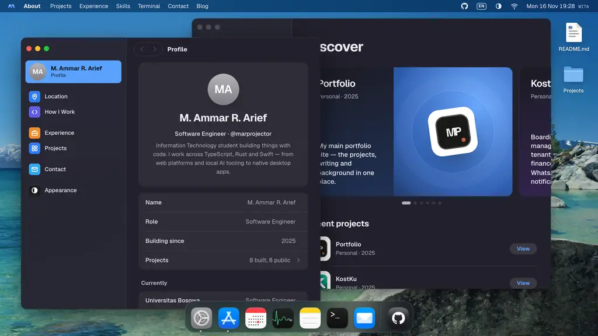
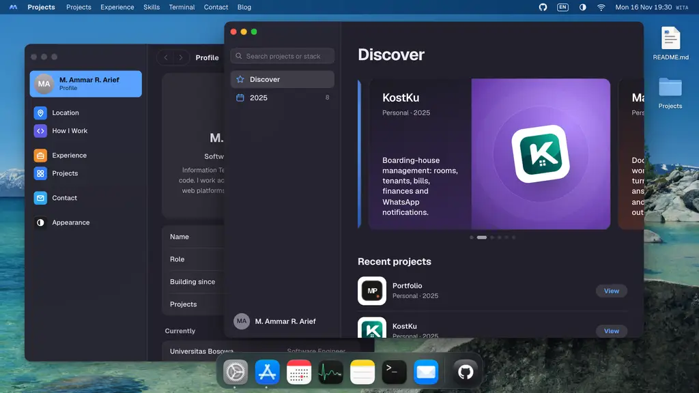
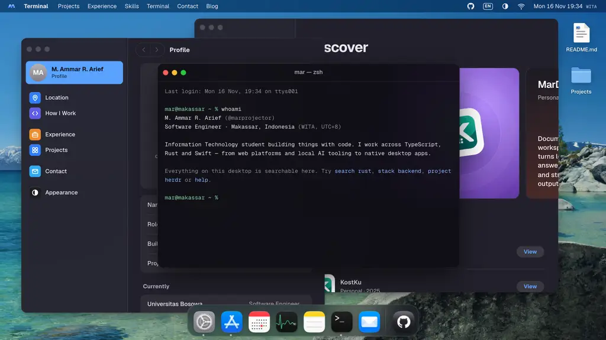
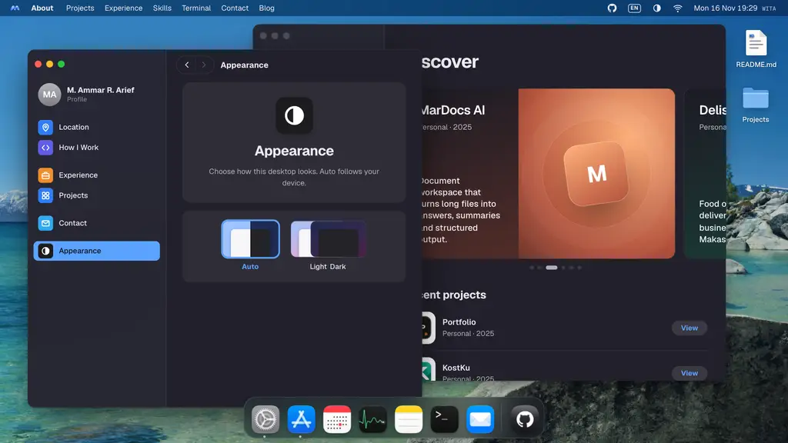

<div align="center">


# Portfolio

**A portfolio that boots like an operating system.**

Not a scrolling page — a macOS-style desktop with a menu bar, draggable
windows, a dock, and nine apps you can actually use. Every word of content is
a JSON file, so changing your projects never means touching a component.

[**ammararief.dev**](https://ammararief.dev)

[](https://ammararief.dev)
[](https://react.dev)
[](https://www.typescriptlang.org)
[](https://vite.dev)
[](https://tailwindcss.com)
[](https://pages.cloudflare.com)

</div>



<div align="center">
<sub>Two windows open: the profile sidebar on the left, the project explorer on the right. Dock at the bottom, live clock in the menu bar.</sub>
</div>

---

## Why a desktop

A portfolio has to answer three questions: who are you, what have you built,
and how do I reach you. A single scroll answers them once and then gets
forgotten. A desktop lets each answer be a place — you can open Projects,
close it, open the Terminal, and the rest of the surface stays where it was.

It also gives the content room to be real: the Terminal runs actual commands
against the same data the windows use, and the project explorer searches it
live.

## The apps

| App | What it does |
|---|---|
| **Profile** | Identity, location, local time, appearance and language switches |
| **Projects** | Searchable explorer with a Discover carousel and a full project list |
| **Experience** | Timeline of roles with the projects each one produced |
| **Tech Stack** | Technologies grouped by layer, each tied to the projects that use it |
| **Notes** | Blog reader backed by Firebase, with a writing dashboard at `/dashboard` |
| **Terminal** | A working shell: `help`, `about`, `project`, `stack`, `find`, `grep`, `cat`, `date`, `clear` |
| **Contact** | Email, social links, one-click copy |
| **Spotify** | Now-playing card, off by default (needs a Premium app owner) |

<table>
<tr>
<td width="50%">

<p align="center"><sub><b>Projects</b> — search, Discover carousel, recent list</sub></p>
</td>
<td width="50%">

<p align="center"><sub><b>Terminal</b> — real commands over the same data</sub></p>
</td>
</tr>
</table>



<div align="center">
<sub><b>Appearance</b> — light, dark, or follow the system. Language switches between English and Indonesian.</sub>
</div>

## Details that took work

- **One window manager, not nine modals.** Dragging, focus order, z-index,
  minimise and full-screen all run through a single store, so windows stack and
  restore the way a real desktop does.
- **The wallpaper never flashes.** HTML and body carry the wallpaper inline in
  `<head>`, preloaded, so the first paint is already the desktop instead of a
  navy void.
- **A hand-drawn intro.** A single-stroke `hello` is written out on first visit
  using the Web Animations API, redrawn shorter on later loads in the session,
  and skipped for `prefers-reduced-motion`.
- **Content is data.** Nothing is hardcoded: drop a JSON file in `public/data/`
  and the window, the Terminal and the search index all pick it up.
- **Bilingual.** Every string goes through a `t()` lookup with an Indonesian
  overlay keyed by id, falling back to English for anything untranslated.

## Stack

| Layer | Choice |
|---|---|
| Framework | React 19 + Vite 7 |
| Language | TypeScript 5.8 (strict) |
| Styling | Tailwind 4 + a scoped desktop stylesheet |
| Routing | React Router 7 (`BrowserRouter`) |
| Editor | Quill (blog dashboard) |
| Charts | Recharts (visitor statistics) |
| Backend | Firebase — Firestore, Auth, Analytics |
| Deploy | Cloudflare Pages |

## Run locally

```bash
npm install
npm run dev      # http://localhost:5173
npm run build    # type-check + production build into dist/
npm run preview  # serve the built output
npm run lint     # ESLint
```

## Content — edit JSON, never components

Everything the site says lives in `public/data/`. No rebuild needed for edits:

| File | Holds |
|---|---|
| `profile.json` | Name, nickname, role, description, contact details |
| `projects.json` | Project cards — links, stack tags, optional logo and screenshot |
| `work.json` | Employment history, linked to project ids |
| `stack.json` | Technology categories and their projects |
| `sosials.json` | Social links on the Contact window |
| `i18n/id.json` | Indonesian translations, keyed by id |

A project without an `image` falls back to a coloured tile with its initials,
so an incomplete entry never renders broken.

## Which apps appear

`.env.example` lists the flags. Copy it to `.env.local` for local work, or set
them as repository variables so the build picks them up:

```bash
VITE_SHOW_ABOUT=true
VITE_SHOW_PROJECTS=true
VITE_SHOW_EXPERIENCE=true
VITE_SHOW_STACK=true
VITE_SHOW_NOTES=true
VITE_SHOW_TERMINAL=true
VITE_SHOW_CONTACT=true
VITE_SHOW_SPOTIFY=false   # off: the Web API 403s without a Premium owner
```

## Deploy

Cloudflare Pages builds this repo directly: build command `npm run build`,
output directory `dist`. `public/_redirects` carries the SPA fallback
(`/* /index.html 200`) so deep links like `/blog` resolve on refresh instead of
404ing.

`.github/workflows/build.yml` runs the same build on every push and uploads
`dist/`, so TypeScript errors surface before a deploy rather than during one.

The Spotify app needs a PHP host for `public/api/spotify.php`; Pages cannot run
PHP, which is the other reason it ships disabled.

---

<div align="center">
<sub>Built by <a href="https://github.com/marprojector">@marprojector</a> · <a href="https://ammararief.dev">ammararief.dev</a></sub>
</div>
